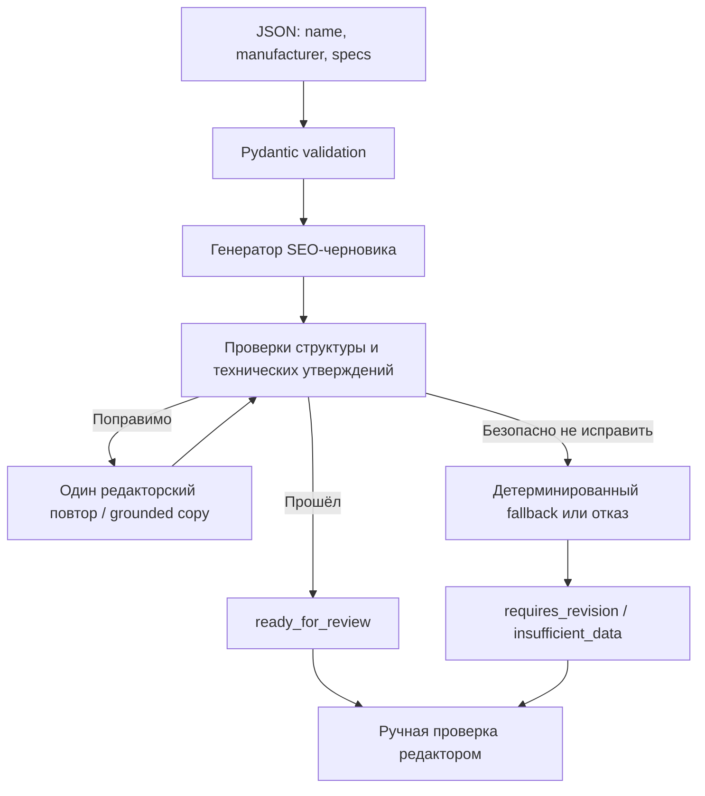

# B2B Product Content Generator — проверяемое офлайн-демо

**Версия:** v0.1.3. Эта демонстрация не требует действующего ключа GigaChat и не воспроизводит промышленную нагрузку. Опирается на [примеры поставки](../examples/submission/), [происхождение результатов](../examples/submission/provenance.json), [приёмку v0.1.3](ACCEPTANCE_v0.1.3.md), [инструкцию проверяющему](REVIEWER_GUIDE.md) и [HTTP API](../app/main.py).

## Последовательность



`specifications` в выходной карточке формируются из исходных `specs`, а не переписываются моделью. Текстовые поля проходят проверки структуры и подозрительных технических утверждений. Статус `ready_for_review` **не разрешает** автоматическую публикацию.

## Рецензентский сценарий

1. Откройте [входные характеристики термометра РОСМА](../examples/submission/products/rosma_bt_51_211.json) и [второй товар серии](../examples/submission/products/meter_dm02_series.json).
2. Сравните с сохранёнными [результатом термометра](../examples/submission/results/rosma_bt_51_211.json) и [результатом серии](../examples/submission/results/meter_dm02_series.json).
3. Сверьте `specifications` с входом, проверьте `status`, `missing_fields`, `warnings` и `generation_meta.seo_source`. Не интерпретируйте `ready_for_review` как редакторское одобрение.
4. Изучите [provenance.json](../examples/submission/provenance.json): результат — воспроизведение сохранённых ответов и локальный fallback, **не новый успешный ответ GigaChat**.
5. Запустите тесты на собственной машине без токенов:

```powershell
py -3.12 -m venv .venv
.\.venv\Scripts\python.exe -m pip install -e ".[dev]"
.\.venv\Scripts\python.exe -m scripts.run_acceptance
.\.venv\Scripts\python.exe -m pytest -q --cov=app --cov-branch --cov-fail-under=95
```

## На что обратить внимание на собеседовании

| Решение | Зачем |
|---|---|
| Отдельные `specs` | Удержать технические характеристики от переписывания LLM |
| `generation_meta` и reason codes | Объяснить выбранный маршрут и автоматические предупреждения |
| Валидаторы и grounded fallback | Не подменять отсутствующие факты уверенным текстом |
| Ручная редактура | Разделить формальные quality gates и смысловую достоверность |

**Граница доказательств:** в v0.1.3 подтверждены 723 теста и 95,45% branch coverage по опубликованной приёмке; на трёх реальных товарах до последних защитных изменений зафиксированы два fallback и один гибридный результат. Текущий редакторский критерий ≥4/5 не подтверждён; промышленная готовность и точность будущих LLM-ответов не гарантируются.
